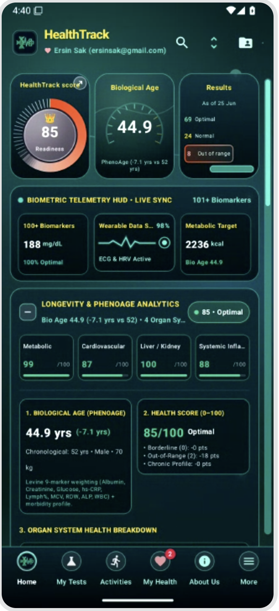
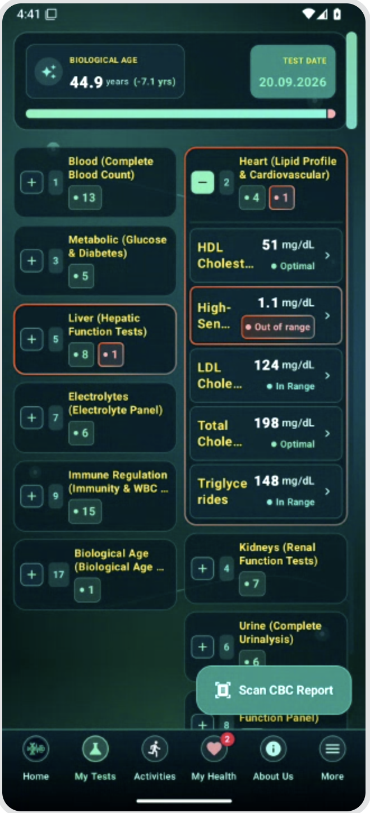
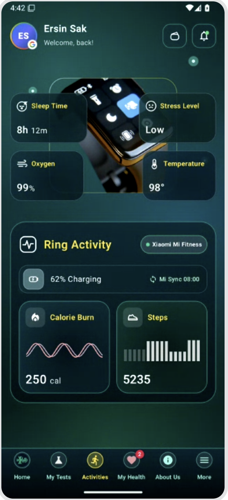
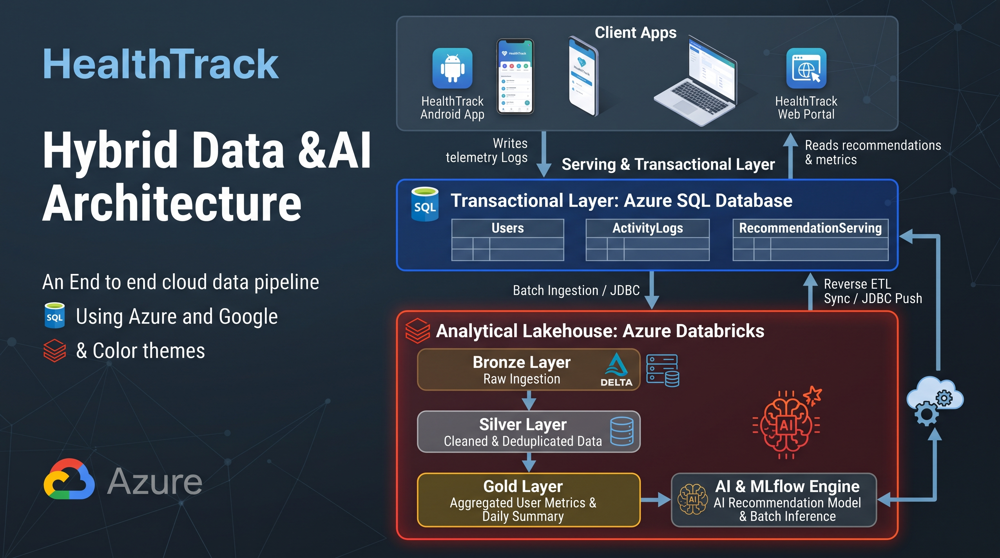

<div align="center">

# 🩺 HealthTrack

**A personal health biomarker tracker for Android, with an Azure Databricks lakehouse behind it.**

Scan your lab reports, track 100+ biomarkers over time, estimate your biological age, and turn the data into insights.


</div>

---

## 📱 Screenshots

<table>
  <tr>
    <td align="center"></td>
    <td align="center"></td>
    <td align="center"></td>
  </tr>
  <tr>
    <td align="center"><b>Home</b><br/><sub>HealthTrack score, biological age (PhenoAge), and organ-system health</sub></td>
    <td align="center"><b>My Tests</b><br/><sub>Biomarkers grouped by panel, with reference ranges and out-of-range flags</sub></td>
    <td align="center"><b>Activities</b><br/><sub>Wearable data: sleep, stress, SpO₂, temperature, calories, and steps</sub></td>
  </tr>
</table>

---

## ✨ Features

### 🧪 Lab results and biomarkers
- **Scan lab reports with AI:** take a photo of a lab report (for example a CBC). Gemini extracts each biomarker, its value, unit, and test date.
- **Manual entry:** add or correct values by hand.
- **100+ biomarkers in 17 panels:** blood count, lipid profile, metabolic, liver, kidney, electrolytes, urinalysis, immunity, thyroid, and more.
- **Range status:** each value is marked *Optimal*, *In Range*, or *Out of range*. Panels with out-of-range values are highlighted.
- **Trend charts:** see how each biomarker changes over time, filtered by time period.

### 🧬 Longevity analytics
- **Biological age (PhenoAge):** uses the Levine 9-marker formula (albumin, creatinine, glucose, hs-CRP, lymphocyte %, MCV, RDW, ALP, WBC) and compares the result with your actual age.
- **HealthTrack score (0–100):** a readiness score that subtracts points for borderline values, out-of-range values, and chronic conditions.
- **Organ-system breakdown:** separate scores for metabolic, cardiovascular, liver/kidney, and systemic inflammation.
- **Biomarker guidance:** explains what each marker means and what to do when it's out of range.

### ⌚ Activity and wearables
- Sleep time, stress level, blood oxygen, and body temperature.
- Calories burned and daily steps from a fitness ring or band (Xiaomi Mi Fitness).

### 🗂️ More
- **Document vault:** keep your medical PDFs and scanned reports in one place.
- **My Health:** track your ongoing health issues.
- **Google Sign-In** with Firebase Auth. Firebase App Check protects the backend.
- **English and Turkish** interface.

---

## 🏗️ Architecture



The diagram shows the **target architecture**. It is an end-to-end data and AI pipeline on Azure and Google Cloud:

| Layer | Role |
|---|---|
| **Client apps** | The Android app (and later a web portal) records lab results and activity data, and shows recommendations. |
| **Serving / transactional** | Operational store for users, activity logs, and the recommendations the apps display. |
| **Bronze** | Raw data copied in from the operational store, stored as Delta tables. |
| **Silver** | Cleaned, deduplicated, and type-corrected records. |
| **Gold** | Per-user metrics and daily summaries, ready for analytics and BI. |
| **AI and MLflow** | Recommendation models and batch inference. The results are pushed back to the serving layer (reverse ETL). |

### What's implemented today

```
Android app ──► Firebase (Auth · Firestore) ──► Databricks job (serverless, hourly, incremental MERGE)
     │                                                │
     └── Gemini (lab report OCR)                      ├──► healthtrack.core.*   (users, biomarkers, lab_results, documents)
                                                      └──► healthtrack.ops.sync_state (watermarks)
```

- The app stores its data in **Room** (on the device) and syncs it to **Cloud Firestore**.
- A **Databricks Lakeflow job** reads Firestore with the Admin SDK. It only fetches documents changed since the last run (tracked by `updatedAt`), handles soft deletes, and MERGEs the changes into **Unity Catalog** Delta tables. Change Data Feed is turned on for all of them.
- **Terraform** creates the catalog, schemas, tables, grants, and the sync job. Table columns are defined in a single file, [`schema/tables.json`](databricks/schema/tables.json).

For setup details, see [`databricks/README.md`](databricks/README.md).

---

## 🛠️ Tech stack

| Area | Technologies |
|---|---|
| **Mobile** | Kotlin, Jetpack Compose, Material 3, CameraX, Room, Coroutines, Retrofit, OkHttp, Moshi |
| **Backend** | Firebase Auth (Google Sign-In / Credential Manager), Cloud Firestore, Firebase App Check |
| **AI** | Gemini via Firebase AI Logic, for lab report OCR and structured data extraction |
| **Data platform** | Azure Databricks, Unity Catalog, Delta Lake, serverless Lakeflow Jobs, SQL Warehouse |
| **Infrastructure** | Terraform (Databricks provider), Firebase CLI |

---

## 📂 Project structure

```
HealthTrack/
├── app/                          # Android app (Jetpack Compose)
│   └── src/main/java/com/example/
│       ├── ui/
│       │   ├── screens/          # Dashboard, Scan Report, Guidance, Document Vault, My Health, ...
│       │   ├── components/       # Biomarker cards, trend chart, category filters, bottom nav
│       │   ├── camera/           # CameraX lab report capture
│       │   ├── viewmodel/        # VitalTrackViewModel + UI state
│       │   └── localization/     # EN / TR strings
│       └── data/
│           ├── local/            # Room entities and DAOs
│           ├── ocr/ service/     # Gemini lab report extraction
│           ├── model/            # Biomarker definitions and categories
│           └── repository/
├── databricks/
│   ├── schema/tables.json        # Single source of truth for table columns
│   ├── jobs/firestore_sync/      # Firestore → Delta incremental sync
│   └── terraform/                # Catalog, schemas, tables, grants, job
├── docs/images/                  # README screenshots
├── firestore.rules               # Firestore security rules
└── firestore.indexes.json        # Collection-group indexes for incremental sync
```

---

## 🚀 Getting started

### Android app

**Prerequisites:** [Android Studio](https://developer.android.com/studio), a Firebase project, and a Gemini API key.

1. Open the project in Android Studio and let Gradle sync.
2. Copy `.env.example` to `.env` and set `GEMINI_API_KEY`.
3. Add your Firebase `google-services.json` to `app/`.
4. For local builds outside AI Studio, remove `signingConfig = signingConfigs.getByName("debugConfig")` from `app/build.gradle.kts`.
5. Run on an emulator or a device (Android 7.0 / API 24 or later).

### Data platform (optional)

```bash
cd databricks/terraform
cp terraform.tfvars.example terraform.tfvars   # set the workspace host and SQL warehouse ID
terraform init && terraform apply
```

Then store the Firebase service account in a Databricks secret and deploy the Firestore indexes. The full steps are in [`databricks/README.md`](databricks/README.md).

---

## 🔒 Privacy

HealthTrack handles **health data (PHI) and personal data (PII)**: lab results, OCR text, and email addresses.

- Firestore security rules limit each user to their own documents.
- In Databricks, read access goes only to explicitly listed principals. Use Unity Catalog column masks before giving anyone broader access.
- Never commit `.env`, service account keys, or keystores.

> **Disclaimer:** HealthTrack is for informational purposes only. It is not a medical device and does not replace professional medical advice.

---

<div align="center">

Built by **Ersin Sak** · Data Architect

</div>


# Deploy Your Lakehouse Architecture

## Purpose

This set of terraform templates is designed to allow every industry practitioner and devops team to get started quickly with the canonical Regulated Industries security best practices and governance setup as well as highly valuable industry libraries and quickstarts directly in your environment.


---

## Details on what is Packaged

What's include in this sequence of Terraform modules?

### AWS | Azure

There are 4 main modules which can be composed together. (1-4). There is also a full end-to-end example of a workspace deployment with governance and industry quickstarts included. See the `test_aws_full_lakehouse_example` for this version.

1. Creation of Databricks-compliant VPC in `aws_base` or `azure_spoke_vnet` (AWS | Azure)
2. Platform Security Built in to Workspace deployment in `aws_customer_managed_vpc` and `azure_vnet_injected_databricks_workspace` module (Private Link, VPC endpoints, and secure connectivity) (AWS | Azure)
3. Unity Catalog Installation in `aws_uc` and `azure_uc` module (AWS | Azure)
4. Industry Quickstarts with Sample Job and Pre-installed Libraries for Time Series, Common Domain Models (see `aws_fs_lakehouse` module)
5. Full End-to-End example on AWS for Composition of all modules above (see below). This composed example is available the examples folder (test_full_aws_lakehouse_example) This can be similarly applied for Azure modules.

```hcl
module "aws_base" {
  source                      = "../../modules/aws_base/"
  cidr_block                  = var.cidr_block
  tags                        = var.tags
  region                      = var.region
  databricks_account_password = var.databricks_account_password
  databricks_account_id       = var.databricks_account_id
  databricks_account_username = var.databricks_account_username
}

data "aws_vpc" "prod" {
  id = module.aws_base.vpc_id
}


module "aws_customer_managed_vpc" {
  source                      = "../../modules/aws_customer_managed_vpc/"
  databricks_account_id       = var.databricks_account_id
  databricks_account_username = var.databricks_account_username
  databricks_account_password = var.databricks_account_password
  region                      = var.region
  relay_vpce_service          = var.relay_vpce_service
  workspace_vpce_service      = var.workspace_vpce_service
  vpce_subnet_cidr            = cidrsubnet(data.aws_vpc.prod.cidr_block, 3, 3)
  vpc_id                      = module.aws_base.vpc_id
  subnet_ids                  = module.aws_base.subnets
  security_group_id           = module.aws_base.security_group[0]
  cross_account_arn           = module.aws_base.cross_account_role_arn

  providers = {
    databricks = databricks.mws
  }
  depends_on = [module.aws_base]
}


module "aws_uc" {
  source                      = "../../modules/aws_uc/"
  databricks_account_id       = var.databricks_account_id
  databricks_account_username = var.databricks_account_username
  databricks_account_password = var.databricks_account_password
  region                      = var.region
  workspaces_to_associate     = [split("/", module.aws_customer_managed_vpc.workspace_id)[1]]
  databricks_workspace_url    = module.aws_customer_managed_vpc.workspace_url
}


module "aws_fs_lakehouse" {
  source                      = "../../modules/aws_fs_lakehouse/"
  workspace_url               = module.aws_customer_managed_vpc.workspace_url
  databricks_account_username = var.databricks_account_username
  databricks_account_password = var.databricks_account_password
  crossaccount_role_name      = split("/", module.aws_base.cross_account_role_arn)[1]
  allow_ip_list               = var.allow_ip_list
  use_ip_access_list          = var.use_ip_access_list

  providers = {
    databricks = databricks.workspace
  }

  depends_on = [module.aws_uc]
}
```

### Azure-Specific Changes

* Hub and Spoke Architecture with Azure Databricks workspace created per Spoke - The infrastructure deployed matches the design in the Data Exfiltration Prevention blog released by Databricks [here](https://www.databricks.com/blog/2020/03/27/data-exfiltration-protection-with-azure-databricks.html)

### GCP

* Bring-your-own-VPC configuration with GCP (see GCP folder)
